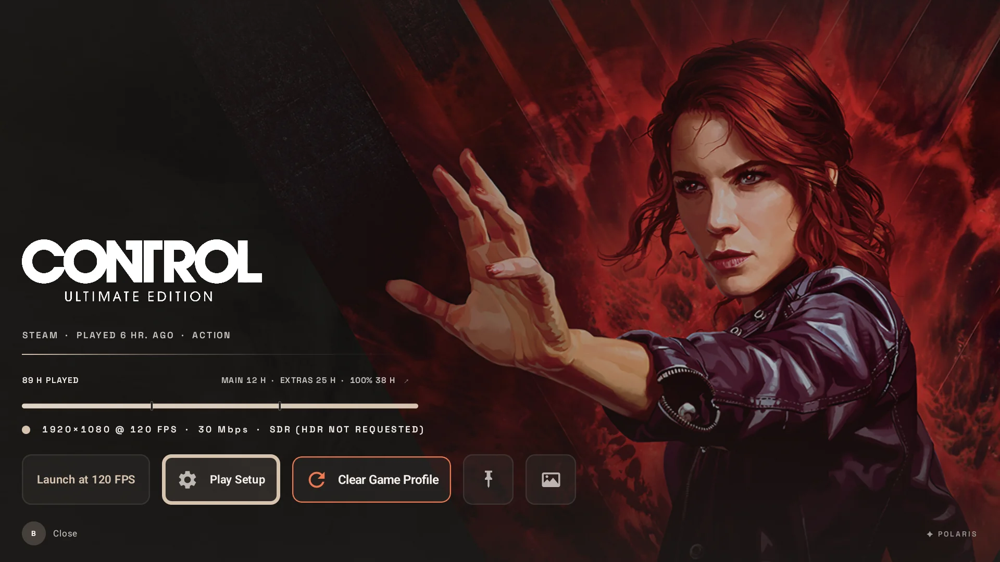
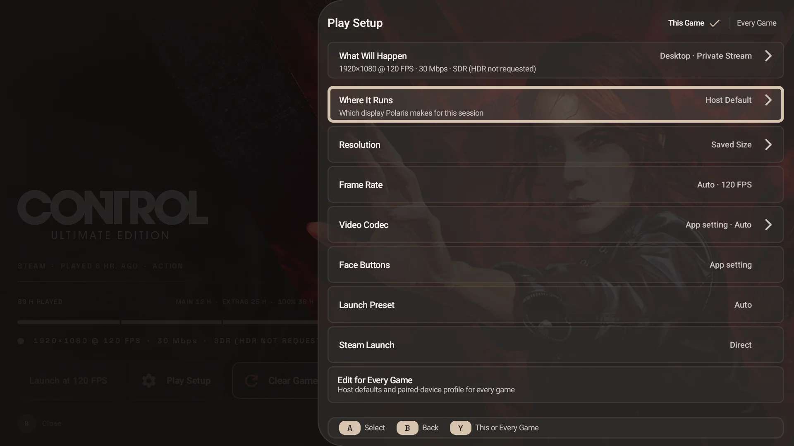
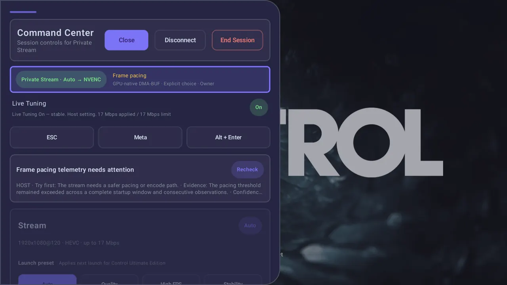

<div align="center">

<picture>
  <source media="(prefers-color-scheme: dark)" srcset="docs/screenshots/Polaris_icon_1_dark.svg">
  
</picture>

# Nova

**The streaming client that speaks host.**

Stream PC games to Android or Linux with a controller-first Library, clear
launch plans and live controls. Pair with Polaris for the full experience;
standard Moonlight-compatible hosts work too.

[](https://github.com/papi-ux/nova/stargazers)
[](https://matrix.to/#/#papi-ux:papi-ux.com)
[](LICENSE.txt)
[](https://github.com/papi-ux/nova/releases/latest)

[**Explore Nova**](https://papi-ux.com/nova/) ·
[**Install ARM64**](https://github.com/papi-ux/nova/releases/latest/download/Nova-Android-arm64-v8a.apk) ·
[Join the Matrix community](https://matrix.to/#/#papi-ux:papi-ux.com) ·
[All releases](https://github.com/papi-ux/nova/releases) ·
[Quick start](https://papi-ux.com/docs/nova/quickstart/)

</div>


## Platforms and availability

| Client | Package and channel | Scope |
| --- | --- | --- |
| Android | Stable APKs below; separate `Nova-Beta-Android-<ABI>.apk` for published betas | Phones, tablets, TVs and handhelds; choose the Android app ABI |
| Linux x86_64 | `Nova-Linux-x86_64-alpha.flatpak` from the selected release | Native desktop/laptop/handheld alpha, including Steam Deck |
| Steam Frame ARM64 | Planned beta.2 `Nova-Linux-aarch64-frame-alpha.flatpak` plus checksum | Experimental native 2D alpha; separate installation and manual updates |

**Public 1.5.0-beta.2 delivery is pending.** Latest links still select stable;
use the assets and notes of the release you install. The candidate features
below do not imply beta.2 is already downloadable.



*Android 1.4.14-beta.1 candidate; screenshot provenance is linked below.*

## Built for the whole player loop

- **Review before play.** Play Setup names resolution, frame rate, codec and
  where the game runs. Per-session choices leave host defaults alone.
- **Make it yours.** Stage, Regular and Compact support touch and controllers;
  text and control sizes are independent. Polaris Aurora stays the default;
  `< Congratulations, Director >` adds charcoal, warm white and red.
- **Stay in control.** Command Center brings Doctor, tuning, NovaHUD, input
  helpers and Steam controls together. Close returns input to the stream;
  Disconnect leaves the game running; End Session confirms a request to stop
  the owned game.
- **Keep context.** Library sources, Spaces, Watch and launch refusals stay
  bound to the host's actual capabilities. [Reports](docs/stream-reports.md)
  preserve readings without sending anything automatically.

Standard Moonlight-compatible hosts still support pairing, browsing, Wake-on-LAN,
launch, input and streaming. Polaris adds its Library, Play Setup, session
ownership, Doctor and tuning context. Steam controls and the Tailscale readout
require a Polaris 1.5.0 beta.2 host; older hosts keep the standard path.

## Browse, decide, control

Browse the [theme gallery](https://papi-ux.com/nova/#themes), then review Play
Setup before launching. Advice is a starting target, not a capacity guarantee.





The game-page and Play Setup images are **1.4.14-beta.1 candidate** captures
([provenance](docs/screenshots/beta1-readme-provenance.json)); Command Center is
an older **1.4.9 reference**, not the corrected Frame panel. Other website
images retain their [original provenance](https://papi-ux.com/images/products/showcase-v1.3.8-v1.3.6-provenance.json).


## Install and start a first stream

Choose [Android](#android) or [Nova Linux](#nova-linux-alpha). Stable downloads
use **Latest**; published betas appear separately under
[Releases](https://github.com/papi-ux/nova/releases).

### Android

<div align="center">

[](https://apps.obtainium.imranr.dev/redirect?r=obtainium://app/%7B%22id%22%3A%22com.papi.nova%22%2C%22url%22%3A%22https%3A%2F%2Fgithub.com%2Fpapi-ux%2Fnova%22%2C%22author%22%3A%22papi-ux%22%2C%22name%22%3A%22Nova%22%2C%22additionalSettings%22%3A%22%7B%5C%22apkFilterRegEx%5C%22%3A%5C%22Nova-Android-arm64-v8a%5C%5C%5C%5C.apk%24%5C%22%2C%5C%22versionExtractionRegEx%5C%22%3A%5C%22v%28.%2B%29%5C%22%2C%5C%22matchGroupToUse%5C%22%3A%5C%221%5C%22%7D%22%7D)
&nbsp;
[](https://github-store.org/app?repo=papi-ux/nova)
&nbsp;
[](https://github.com/papi-ux/nova/releases/latest)
&nbsp;
[](https://github.com/papi-ux/nova/releases/latest/download/Nova-Android-arm64-v8a.apk)

</div>

1. Install the public APK that matches the Android device.
2. Open **Hosts**, discover or add the host, and pair.
3. Open the Library, review a title, and launch.
4. During play, open Command Center with Guide/Mode + Start/Menu. Guide/Mode + Y
   shows or cycles NovaHUD.

| Architecture | Direct download | Typical devices |
|---|---|---|
| ARM64 | [Nova-Android-arm64-v8a.apk](https://github.com/papi-ux/nova/releases/latest/download/Nova-Android-arm64-v8a.apk) | Most current handhelds, phones and devices with ARM64 Android app support |
| ARMv7 | [Nova-Android-armeabi-v7a.apk](https://github.com/papi-ux/nova/releases/latest/download/Nova-Android-armeabi-v7a.apk) | 32-bit ARM Android devices, including Shield models with a 32-bit app ABI |
| x86_64 | [Nova-Android-x86_64.apk](https://github.com/papi-ux/nova/releases/latest/download/Nova-Android-x86_64.apk) | Android x86_64 devices and emulators |

Choose by the **Android app ABI**, not the processor name: a 64-bit CPU can
run a 32-bit Android build. Beta APKs use `Nova-Beta-Android-<ABI>.apk` and install
as Nova Beta beside stable, with separate app data.

Guides: [Quick start](https://papi-ux.com/docs/nova/quickstart/) ·
[Updates and beta releases](docs/updates.md) ·
[PyroWave](docs/pyrowave-android.md).

### Nova Linux (Alpha)

Download `Nova-Linux-x86_64-alpha.flatpak` and its checksum from the chosen
[release](https://github.com/papi-ux/nova/releases), then install on Linux:

```bash
flatpak install --user ./Nova-Linux-x86_64-alpha.flatpak
flatpak run com.papi_ux.Nova --standalone
```

The 1.5 beta standard bundle includes experimental SDR PyroWave. Selecting it
runs a device check; Auto, H.264 and HEVC skip it. Older separate PyroWave bundles
have a [migration guide](clients/deck/docs/pyrowave.md#packaging-and-compatibility).

See the [Linux guide](clients/deck/README.md),
[Flatpak and Steam Input setup](clients/deck/packaging/flatpak/README.md),
[compatibility roadmap](docs/linux-client-roadmap.md) and
[Steam Deck guide](https://papi-ux.com/docs/nova/steam-deck/). Steam is optional
for ordinary Linux use.

### Steam Frame (experimental ARM64)

The x86_64 bundle does not run on Frame. The planned beta.2 pair is
`Nova-Linux-aarch64-frame-alpha.flatpak` and its `.sha256` sidecar; download
only from the matching published prerelease. Follow the
[Frame alpha guide](clients/deck/docs/steam-frame.md#public-alpha) for its
isolated installation, Steam launcher, gamepad Steam Input layout and rollback.
There is no Frame update feed; the signed Linux feed is x86_64 only. Separate
alpha settings do not isolate all `~/.var/app` data: never use `--delete-data`.

Short checks covered 1920×1080 SDR at requested 60 fps: H.264/HEVC/PyroWave
picture, sound, controllers and readable Command Center actions. H.264/HEVC
use V4L2 decode with CPU upload; PyroWave uses Vulkan/DMA-BUF. Sustained
performance, color/clarity, higher rates, HDR and immersive XR remain
unqualified; this is not Steam Frame Verified support. The guide records the
tested runtime; a fresh current-Flathub runtime installation is untested.

## Reports, connection facts and experimental scaling

**Android only:** [Tailscale connection facts and per-host profile rules](docs/network-profiles.md).
Confirmed host-daemon evidence can name direct/relay paths for the paired
control connection, not the video/audio route. An installed VPN, address or
hostname is not proof; unavailable evidence stays unknown. Rules select a
saved profile for one launch without rewriting the active profile or host.

[Report This Moment and Working baseline](docs/stream-reports.md) exist on
Android and Linux. Android's Last Stream is an in-memory connection recap,
not proof of visible recovery or game shutdown. Save/share is explicit.

[Android PyroWave and SGSR 1](docs/pyrowave-android.md) are experimental.
SGSR is **off by default**, applies to eligible smaller 8-bit SDR streams in
Fit/Stretch, and adds no detail the stream did not carry. A small offscreen GPU
check found unresolved noise-pattern differences from its reference; same-scene
picture comparison remains pending, with no wider quality verdict. CPU API
return times and submitted-frame counters do not measure GPU completion,
presentation latency or scanout.

## Compatibility and platform boundaries

Android 5.0 / API 21 remains supported. Codec, HDR, controls and rates depend
on the device, drivers, display and host; consult the
[compatibility guide](https://papi-ux.com/docs/nova/compatibility/).


## Documentation and project links

- [Spaces In Nova](docs/spaces.md): open your assigned gaming Space and adjust its stream settings.

- [Nova documentation](https://papi-ux.com/docs/nova/) · [Play Setup](https://papi-ux.com/docs/nova/play-setup/) · [Quick start](https://papi-ux.com/docs/nova/quickstart/) · [Compatibility](https://papi-ux.com/docs/nova/compatibility/)
- [Roadmap](https://papi-ux.com/docs/roadmap/) · [Changelog](CHANGELOG.md) · [Releases](https://github.com/papi-ux/nova/releases)
- [Matrix community](https://matrix.to/#/#papi-ux:papi-ux.com) · [Issues](https://github.com/papi-ux/nova/issues) · [Discussions](https://github.com/papi-ux/nova/discussions) · [Source](https://github.com/papi-ux/nova)
- [Security policy](SECURITY.md) · [Contributing](.github/CONTRIBUTING.md)

## Acknowledgments

Thanks to the Moonlight community for Nova's moonlight-android foundation.

## AI Transparency

I use tools including Codex, Claude and local models for research, drafting,
review and debugging. I review and test changes, decide what ships, and own
the engineering and trust-boundary decisions.

## Contributing

Focused fixes, docs, translations and careful feature work are welcome.
Explain the problem and keep changes scoped; see [CONTRIBUTING](.github/CONTRIBUTING.md).

## License

Nova is free and open-source software licensed under the [GNU General Public
License v3.0](LICENSE.txt).

<div align="center">


<picture>
  <source media="(prefers-color-scheme: dark)" srcset="docs/screenshots/Polaris_icon_1_dark.svg">
  
</picture>

<sub>[Website](https://papi-ux.com/nova/) · [Matrix](https://matrix.to/#/#papi-ux:papi-ux.com) · [Documentation](https://papi-ux.com/docs/nova/) · [Releases](https://github.com/papi-ux/nova/releases) · [Security](SECURITY.md)</sub>

</div>
