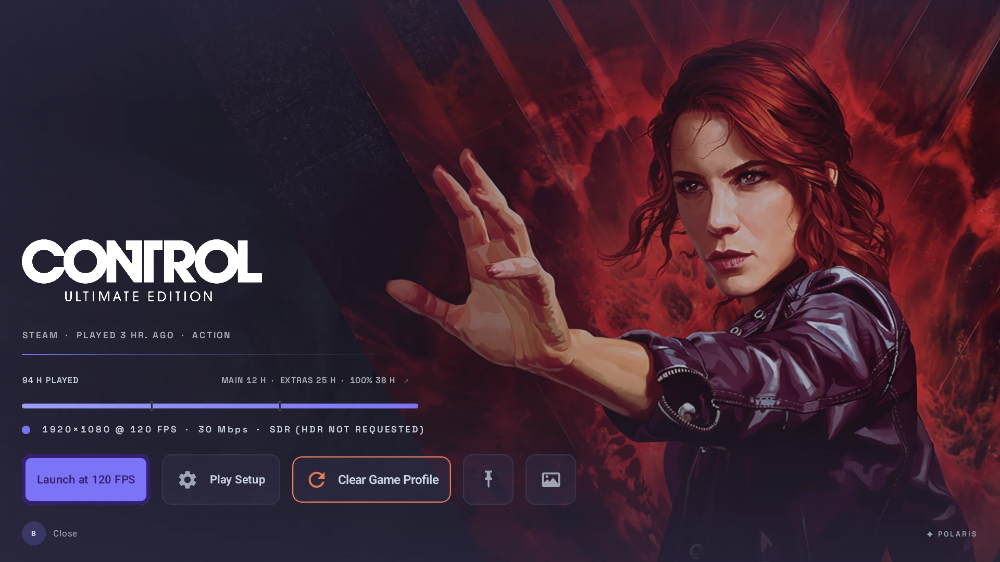
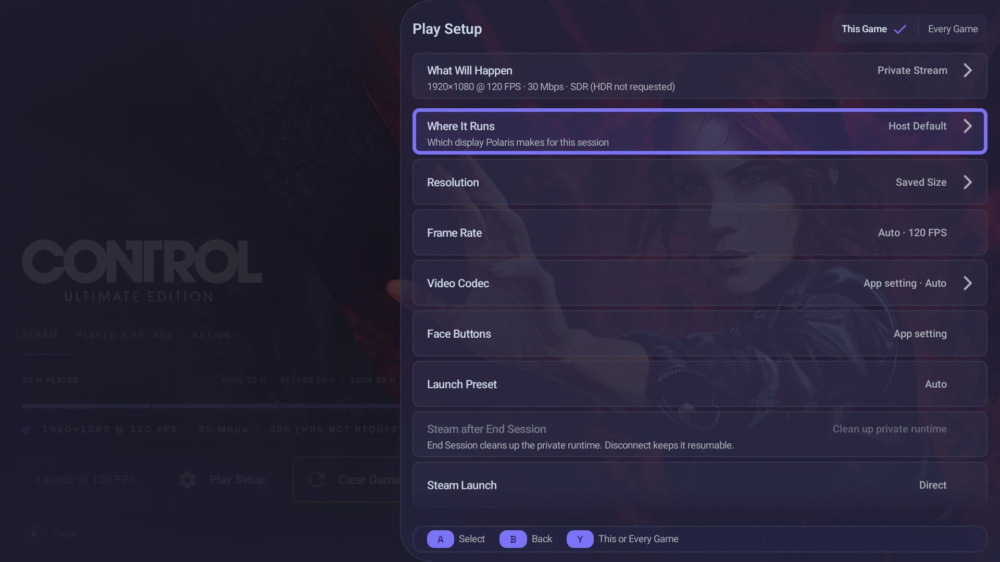

<picture>
  <source media="(prefers-color-scheme: dark)" srcset="docs/screenshots/Polaris_icon_1_dark.svg">
  
</picture>

# Nova

**Your PC games, in your hands.**

Nova plays games from your PC on Android handhelds, phones, tablets and TVs.
Browse your library like a console, see exactly how a game will launch before
it starts, and keep the stream's controls a shortcut away. It's at its best
with Polaris on a Linux PC, and other Moonlight-compatible hosts work too.
Native Linux, Steam Deck and Steam Frame builds are available in Beta.

[**Get Nova**](https://papi-ux.com/downloads/?product=nova) ·
[Explore Nova](https://papi-ux.com/nova/) ·
[Quick start](https://papi-ux.com/docs/nova/quickstart/) ·
[Join the Matrix community](https://matrix.to/#/#papi-ux:papi-ux.com)

A game page on a handheld: your play time, the stream Nova will ask for,
and everything you need before you press Launch.

## What Nova does

Nova is a free, open-source game-streaming client made for the device in your
hands. It pairs with the PC where your games live, puts that library on your
screen, and stays out of the way while you play.

### Browse and launch

- **A library that feels like a console.** Your host's games appear with their
  cover art, ready to browse with a controller, touch or keyboard. Stage,
  Regular and Compact layouts fit a TV across the room or a handheld in your
  lap, and text and control sizes adjust separately.
- **Know before you press play.** Play Setup shows where the game will run, its
  resolution, frame rate, codec and HDR, before anything starts. A choice for
  one session leaves your host's defaults alone, and its advice is a starting
  point, not a promise about your network.
- **Make the library yours.** Wake a sleeping PC with Wake-on-LAN, pin a
  favorite game to your Android home screen and, with Polaris, fix its artwork
  in Artwork Studio.

Play Setup: every choice for this launch on one screen, for this game or
every game.

### While you play

- **A sharp, smooth picture.** Nova streams H.264, HEVC or AV1, with HDR and
  90 or 120 Hz where your device and host support them.
- **Controls a shortcut away.** Command Center brings tuning, Doctor's advice,
  the NovaHUD stream readout, input helpers and Steam controls over the running
  game. Press Guide + Start to open it and Close to get straight back to play.
- **Leave on your terms.** Disconnect keeps the game running so you can resume
  later. End Session asks before stopping the game you started, and Watch
  joins someone else's stream without taking it over.
- **Your evidence stays with you.** When something looks off,
  [stream reports](docs/stream-reports.md) keep what you saw on your device and
  send nothing unless you share them.

### With Polaris, and with other hosts

- **It understands your host.** With Polaris, Nova knows the launch choices
  your PC offers, from Private Stream to Mirror Desktop, who owns a session,
  what Doctor found and which launch defaults the host keeps. On Android, Host
  Console opens the Polaris console right inside Nova. Any Moonlight-compatible
  host still gets pairing, browsing, Wake-on-LAN, launch and streaming.
- **Settings that follow the network.** On Android, per-PC rules can pick one
  of your saved Settings Profiles by Wi-Fi, Ethernet, cellular, metered or VPN
  connection, and Play Setup can tell you whether your link to the PC runs
  over Tailscale. [Connection facts and profiles](docs/network-profiles.md)
  explains how.

Nova comes in a choice of themes, with Polaris Aurora as the default; see
them in the [theme gallery](https://papi-ux.com/nova/#themes).

## Get started

[**Get Nova**](https://papi-ux.com/downloads/?product=nova) helps you pick the
right download for your device. If you'd rather choose yourself:

| Your device | Download |
| --- | --- |
| Most Android handhelds, phones, tablets and TVs | [Nova-Android-arm64-v8a.apk](https://github.com/papi-ux/nova/releases/latest/download/Nova-Android-arm64-v8a.apk) |
| 32-bit Android, including Shield models with a 32-bit app ABI | [Nova-Android-armeabi-v7a.apk](https://github.com/papi-ux/nova/releases/latest/download/Nova-Android-armeabi-v7a.apk) |
| Android x86_64 devices and emulators | [Nova-Android-x86_64.apk](https://github.com/papi-ux/nova/releases/latest/download/Nova-Android-x86_64.apk) |
| Linux and Steam Deck, **Beta** | The x86_64 Flatpak from [Releases](https://github.com/papi-ux/nova/releases); see the [Linux guide](https://papi-ux.com/docs/nova/linux/) and [Steam Deck guide](https://papi-ux.com/docs/nova/steam-deck/) |
| Steam Frame, **Beta** | A separate ARM64 Flatpak, when included in the selected release; see the [Steam Frame guide](https://papi-ux.com/docs/nova/steam-frame/) |

Choose by the **Android app ABI**, not the processor name: a 64-bit processor
can still offer only 32-bit Android app support.

1. Install Nova, open **Hosts**, find or add your PC, and pair.
2. Pick a game, check Play Setup, and play.
3. During play, Guide + Start opens Command Center. Guide + Y shows or cycles
   NovaHUD.

**Updates and betas.** Follow Nova with
[Obtainium](https://apps.obtainium.imranr.dev/redirect?r=obtainium://app/%7B%22id%22%3A%22com.papi.nova%22%2C%22url%22%3A%22https%3A%2F%2Fgithub.com%2Fpapi-ux%2Fnova%22%2C%22author%22%3A%22papi-ux%22%2C%22name%22%3A%22Nova%22%2C%22additionalSettings%22%3A%22%7B%5C%22apkFilterRegEx%5C%22%3A%5C%22Nova-Android-arm64-v8a%5C%5C%5C%5C.apk%24%5C%22%2C%5C%22versionExtractionRegEx%5C%22%3A%5C%22v%28.%2B%29%5C%22%2C%5C%22matchGroupToUse%5C%22%3A%5C%221%5C%22%7D%22%7D)
or [GitHub Store](https://github-store.org/app?repo=papi-ux/nova).
[Latest](https://github.com/papi-ux/nova/releases/latest) is always stable. A
beta installs as a separate Nova Beta app (`Nova-Beta-Android-<ABI>.apk`) with
its own pairing and preferences; see
[updates and betas](https://papi-ux.com/docs/nova/updates/).

## Good to know

- **Android 5.0 and later.** Codecs, HDR, controls and frame rates depend on
  your device and host. Check the
  [compatibility guide](https://papi-ux.com/docs/nova/compatibility/).
- **This page follows the source**, which can be ahead of the newest release.
  Install only files attached to a published release.
- **Where each feature works.** Steam controls and the Tailscale readout need
  Polaris 1.5.0-beta.2 or newer; an older host says so instead. The Tailscale
  readout, per-PC profile rules and the Last Stream card are Android only for
  now.
- **Native clients in Beta.** Linux, Steam Deck and Steam Frame have playable
  builds in active development. Steam is optional for ordinary Linux use. The
  [Linux guide](https://papi-ux.com/docs/nova/linux/) covers setup and current
  limits; the separate Steam Frame build streams to a virtual 2D screen and
  is not Steam Frame Verified. Beta describes these clients' maturity; stable
  and prerelease downloads remain separate release channels.
- **Experiments to try when you want them.** PyroWave is an experimental codec
  that trades bandwidth for very fast decoding on a fast local network. It's
  off by default on Linux and Steam Frame and in Nova Beta for Android. Nova
  Beta for Android also offers SGSR 1 upscaling, off by default, which
  sharpens edges when a PyroWave SDR stream is smaller than your screen. The
  [PyroWave guide](https://papi-ux.com/docs/pyrowave-beta/) explains when each
  is worth trying.

## Learn more

- [Nova documentation](https://papi-ux.com/docs/nova/) · [Quick start](https://papi-ux.com/docs/nova/quickstart/) · [Play Setup](https://papi-ux.com/docs/nova/play-setup/) · [Spaces in Nova](https://papi-ux.com/docs/nova/spaces/) · [Connection facts and profiles](docs/network-profiles.md) · [Compatibility](https://papi-ux.com/docs/nova/compatibility/) · [Steam Deck](https://papi-ux.com/docs/nova/steam-deck/)
- [Roadmap](https://papi-ux.com/docs/roadmap/) · [Changelog](CHANGELOG.md) · [Releases](https://github.com/papi-ux/nova/releases)
- [Matrix community](https://matrix.to/#/#papi-ux:papi-ux.com) · [Issues](https://github.com/papi-ux/nova/issues) · [Discussions](https://github.com/papi-ux/nova/discussions) · [Security policy](SECURITY.md) · [Contributing](.github/CONTRIBUTING.md) · [Source](https://github.com/papi-ux/nova)

Screenshots: 1.5.0-beta.2 ([details](docs/screenshots/beta2/provenance.json)).
Website gallery: [image sources](https://papi-ux.com/images/products/showcase-v1.3.8-v1.3.6-provenance.json).

## Acknowledgments

Nova for Android grew from moonlight-android, and every Nova build streams
through moonlight-common-c. Thanks to the Moonlight community for that
foundation. SGSR 1 is Qualcomm's Snapdragon Game Super Resolution 1
(BSD-3-Clause), adapted after RubyLight's Vulkan port.

## AI Transparency

I use tools including Codex, Claude and local models for research, drafting,
review and debugging. I review and test changes, decide what ships, and own
the engineering and trust-boundary decisions.

## Contributing

Focused fixes, docs, translations and careful feature work are welcome.
Explain the problem and keep changes scoped; see [CONTRIBUTING](.github/CONTRIBUTING.md).

## License

Nova is free and open-source software licensed under the [GNU General Public
License v3.0](LICENSE.txt).

<picture>
  <source media="(prefers-color-scheme: dark)" srcset="docs/screenshots/Polaris_icon_1_dark.svg">
  
</picture>

[Website](https://papi-ux.com/nova/) · [Matrix](https://matrix.to/#/#papi-ux:papi-ux.com) · [Documentation](https://papi-ux.com/docs/nova/) · [Releases](https://github.com/papi-ux/nova/releases) · [Security](SECURITY.md)

